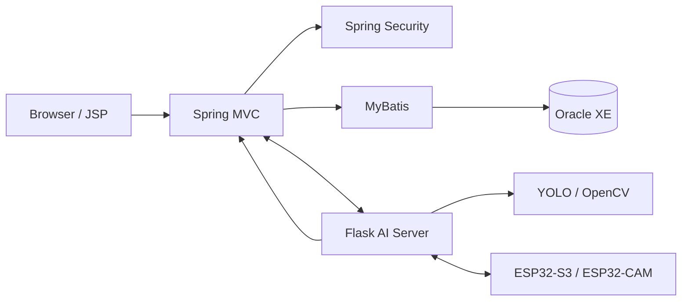
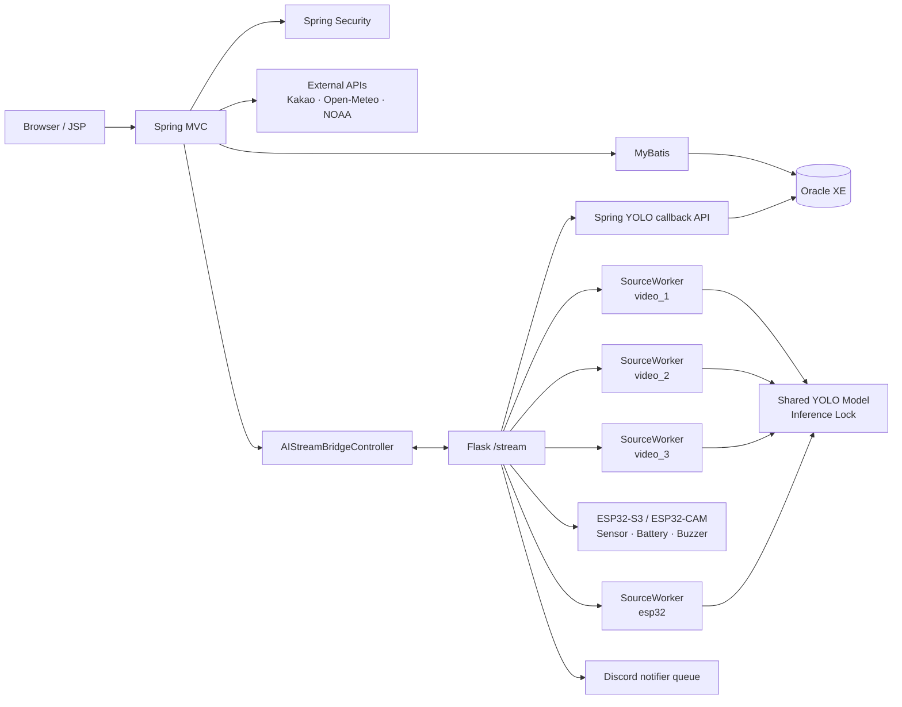
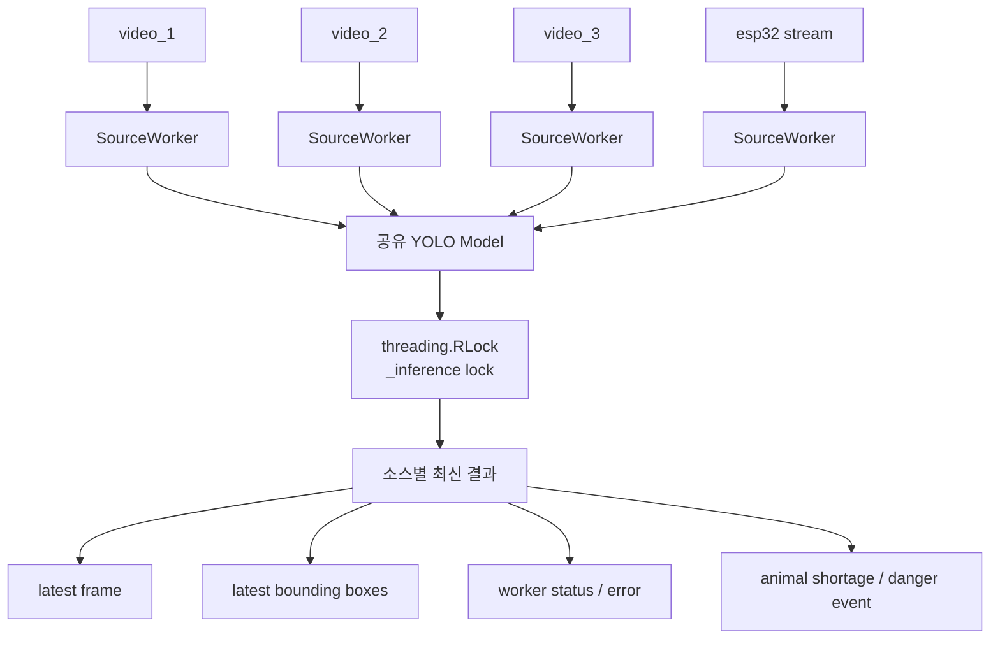

# SSA - 유기동물 보호소 통합 관제 시스템


Spring MVC, Flask, YOLO, Oracle, ESP32를 연동해 실시간 영상 관제, AI 객체 탐지, 센서 모니터링, 경보 알림 및 운영 관리를 제공하는 유기동물 보호소 통합 관제 시스템입니다.

> 이 문서는 Ubuntu WSL2 기준 실행·배포와 현재 저장소의 코드를 설명합니다. 검증 기준일은 2026-10-17입니다. 실제 키, DB 비밀번호, 제어 토큰, Webhook URL은 포함하지 않습니다.

## 현재 Linux 실행 환경과 검증 범위

| 항목 | 확인한 환경 |
| --- | --- |
| OS | Ubuntu 26.04.1 LTS / WSL2 |
| Java / Spring | Java 17, Spring MVC 6.2.19, Spring Security 6.2.8 |
| WAS | Ubuntu 패키지 Tomcat 10.1.55, `tomcat10.service` |
| DB | Windows 호스트의 Oracle 21c XE. 기본 Flask AI 모드는 SQLite 불필요 |
| Python / Flask | 프로젝트 `.venv`의 Python 3.11.17 / Flask 3.1.3 |
| GPU | NVIDIA GeForce RTX 3080 10 GB, Windows 호스트 드라이버 사용 |
| PyTorch / torchvision | 2.7.1+cu126 / 0.22.1+cu126, CUDA runtime 12.6 |
| YOLO / 영상 | Ultralytics 8.4.54, 기존 커스텀 YOLOv8n, OpenCV 4.13.0.92 |

DRONE01~03의 영상·탐지 박스·클래스명 출력과 Spring 화면의 Flask 시작·종료·재시작/AI 준비를 확인했습니다. 실제 서비스 계정과 mount namespace에서 CUDA 추론, 세 입력 영상 접근, 업로드 임시 이미지 저장·재조회, Oracle 읽기 전용 SELECT도 통과했습니다.

DRONE04 ESP32는 연결 대기 중입니다. Discord 실전송·Oracle 탐지 이벤트 INSERT·장시간 관제는 이번 검증에서 수행하지 않았습니다. PDF 캐시 권한은 확인했지만 실제 브라우저 렌더링은 미검증이며, 기존 회원·동물 사진 참조 각 1건의 원본 파일 복구도 남아 있습니다. 구현된 기능과 현재 환경에서 확인한 범위를 구분합니다.

| 상세 문서 | 내용 |
| --- | --- |
| [운영 권한 및 SQLite 분리](LINUX_RUNTIME_PERMISSIONS.md) | ACL·systemd·실제 서비스 계정 검사·백업·남은 작업 |
| [GPU 실행 환경](project_ssa_yolo/GPU_ENVIRONMENT_LINUX.md) | 검증 버전·커스텀 가중치·격리 GPU 검사 |
| [WSL2 배포](project_ssa_spring/DEPLOYMENT_WSL2.md) | WAR·JDBC 리소스·Java 17 JSP 컴파일러 |
| [전체 경로 설정](PATH_CONFIGURATION_LINUX.md) | 경로 인벤토리·환경변수·복사 파일 조사 |
| [업로드 저장소](project_ssa_spring/UPLOAD_STORAGE.md) | 저장 폴더·이미지 조회·권한 정책 |

## 프로젝트 목적과 구현 개요

제한된 인력으로 여러 보호 구역을 동시에 살피기 어려운 문제를 해결하기 위해, 영상 탐지·센서·운영 데이터를 한 화면에 연결했습니다. 동물 개체수 미달과 위험 객체를 감지하고, 관제 이력·조치·보고서까지 이어지는 운영 흐름을 제공합니다.

### 핵심 구현

- 2×2 화면에서 `video_1~3`과 ESP32-CAM을 독립적으로 처리하는 4채널 관제
- 공유 YOLO 모델과 소스별 `SourceWorker`를 통한 최신 프레임 중심의 저지연 추론
- 동물 미달·위험 객체 이벤트, 스냅샷, Discord 알림 queue, Oracle 이력 연동
- ESP32 환경 센서·배터리·부저 상태를 비동기 worker로 분리한 IoT 연동
- Spring Security 권한 제어, 업무 CRUD, Dashboard, PDF 일일 관제 보고서 및 Workflow

### 주요 기술

| 영역 | 기술 |
| --- | --- |
| Backend | Java 17, Spring MVC, Spring Security, MyBatis, Oracle XE |
| AI / Vision | Python, Flask, Ultralytics YOLO, OpenCV, NumPy |
| IoT | ESP32-S3, ESP32-CAM, MicroPython, `mpremote` |
| Frontend | JSP, JSTL, JavaScript, Chart.js |
| Test | JUnit 5, Mockito, pytest |

### System Architecture



### 구현 범위 (저장소 기준)

- Spring MVC 기반 운영 화면, 권한별 메뉴·URL 접근 제어, MyBatis/Oracle CRUD
- Flask 다중 소스 영상 처리, 탐지 정책, Spring callback 및 notification queue
- ESP32 센서/배터리/부저 연동과 ESP32-CAM MJPEG 입력 안정화
- Dashboard, 탐지·경보 이력, FlightHistory, PDF Cache, PatrolReport 및 Workflow

## 프로젝트 소개

유기동물 보호소는 여러 구역의 상태를 지속해서 확인해야 하지만, 제한된 인력으로 모든 구역을 동시에 관찰하기 어렵습니다. 이 과정에서 동물 개체수 부족, 위험 객체 출현, 장비 상태 이상에 대한 대응이 늦어질 수 있습니다.

SSA는 영상·센서·동물 정보·드론 정보·탐지 이력·직원 업무를 하나의 관제 화면으로 연결하는 것을 목표로 합니다. Spring MVC는 운영 화면과 Oracle 데이터를 담당하고, Flask는 다중 영상 처리와 ESP32 연동을 담당합니다.

## 주요 기능

### 1. YOLO 기반 다중 영상 객체 탐지

- `video_1`, `video_2`, `video_3`, `esp32`의 네 영상 소스를 관리합니다.
- 각 소스는 독립적인 `SourceWorker`가 입력 capture를 소유하고 처리합니다. 로컬 영상은 OpenCV를, ESP32-CAM은 전용 HTTP MJPEG reader를 사용합니다.
- Ultralytics YOLO 모델은 한 번만 로드하며 `_model_inference_lock`으로 추론 동시 접근을 보호합니다.
- Worker는 프레임 큐를 무한히 쌓지 않고 `latest_frame`, 최신 bounding box, 상태, 오류를 보관합니다. 따라서 오래된 프레임보다 최신 프레임을 우선해 관제 지연을 줄입니다.
- 탐지 결과는 동물 개체수 부족 정책과 위험 객체 정책으로 분기되고, Spring API와 Discord 알림 작업으로 전달됩니다.

### 2. 4채널 실시간 관제

- 메인 화면은 2×2 관제 레이아웃으로 네 채널을 표시합니다.
- 채널별 탐지 ON/OFF, MJPEG 영상, 탐지 bounding box, 비행 시간, 배터리와 ESP32 센서 HUD를 제공합니다.
- `VIDEO_DRONE_MAP`으로 영상 소스와 드론 ID를 연결합니다.
- 채널 선택 상태는 사이드바 미니 관제 화면에서도 브라우저 세션 범위로 유지합니다.

### 3. ESP32 IoT 연동

- ESP32-S3 / ESP32-CAM 영상 소스를 관제 채널로 처리합니다.
- MicroPython 장치와는 Python의 `mpremote` 호출을 통해 통신합니다.
- 센서 서비스는 온도, 습도, 조도, 거리와 배터리 상태를 캐시해 제공합니다.
- GPIO2 ADC와 40.2kΩ / 10kΩ 전압 분배 회로 기준의 배터리 보정값을 환경변수로 조절할 수 있습니다.
- 부저 명령은 전용 queue worker가 직렬화하여 YOLO Worker를 막지 않도록 구성했습니다.

### 4. 탐지 이벤트, 알림 및 이력

- 동물 미달 탐지는 `DETECTION_LOG`, 위험 객체 탐지는 `DANGER_LOG`에 기록합니다.
- 경보 전송 이력은 `ALERT_LOG`에 연결됩니다.
- Flask는 이벤트별 스냅샷을 만들고, 설정된 경우 Discord Webhook 알림 작업에 전달합니다.
- 드론 탐지 ON/OFF lifecycle은 `FLIGHT_HISTORY`에 비행 시작·종료·배터리 소모량을 기록합니다.
- 개체수 미달은 인식된 보호 동물이 하나 이상 있는 프레임에서만 비교하며, 보호중(`ANIMAL_STATUS = '0'`) 동물 기준 수를 사용합니다.

### 5. 운영 관리 및 보고

- Member, Drone, Animal, CommonCode, 환경 위치, 위험 객체 마스터를 관리합니다.
- 탐지/위험 로그의 현장 조치 상태를 관리하고 Dashboard 통계를 제공합니다.
- PatrolReport와 Workflow로 일일 관제 보고서 및 승인 흐름을 관리합니다.
- 보고서 PDF는 브라우저 렌더링 기반으로 생성되며 `PDF_CACHE`의 `REQUEST` / `SUCCESS` / `FAIL` 상태와 연계됩니다.
- 관리자 Diagnostics 화면에서 Oracle, Flask, YOLO worker, ESP32 센서·부저, Discord, Kakao, Open-Meteo, NOAA 상태를 읽기 전용으로 확인합니다.

### 6. 인증 및 권한

- Spring Security와 BCrypt 기반 비밀번호 해시를 사용합니다.
- `ROLE_ADMIN`, `ROLE_USER`, `ROLE_GUEST` 권한을 사용합니다.
- `ROLE_GUEST`는 이상 관리 메뉴 그룹에 한정되며, 관리자 기능은 `/admin/**`에서 실제 권한 검사를 받습니다.
- JSP 메뉴는 권한에 따라 렌더링되지만, URL 접근 제한은 Spring Security가 별도로 수행합니다.

## 시스템 아키텍처



## YOLO 다중 영상 처리 구조



`SourceWorker`만 자신의 입력 capture를 열고 해제합니다. HTTP MJPEG generator와 Discord worker는 capture를 직접 소유하지 않고, 최신 결과만 읽습니다. 영상 조회 또는 채널 전환은 비행 이력 lifecycle을 시작·종료하지 않으며, 탐지 시작/중지가 그 책임을 가집니다.

## 기술 스택

| 영역 | 실제 사용 기술 |
| --- | --- |
| Frontend | JSP, JSTL, HTML, CSS, JavaScript, Chart.js |
| Backend | Java 17, Spring MVC 6.2.19, Spring Security 6.2.8, MyBatis 3.5.19, Jackson |
| Database | Oracle XE, JDBC, HikariCP, log4jdbc |
| AI / Video | Python 3.11.17, Flask 3.1.3, PyTorch 2.7.1+cu126, torchvision 0.22.1+cu126, Ultralytics 8.4.54, OpenCV, NumPy |
| IoT | ESP32-S3, ESP32-CAM, MicroPython, `mpremote` |
| External API | Kakao Local, Open-Meteo, NOAA SWPC, Discord Webhook |
| Server | Apache Tomcat 10.1.55 / systemd, Werkzeug threaded server (`run_server.py`) |
| Build / Test | Maven, JUnit 5, Mockito, pytest |
| Development | Eclipse, VS Code, SQL Developer, Thonny, Git |

## 데이터베이스

Oracle XE를 사용합니다. 신규 개발 DB는 아래 초기화 스크립트 순서로 구성합니다.

| 대상 | 내용 |
| --- | --- |
| `project_ssa_spring/db_script/01_schema.sql` | 현재 Mapper가 사용하는 19개 테이블, PK/FK, CHECK 제약, 기본값, 테이블 설명 및 인덱스 |
| `project_ssa_spring/db_script/02_sequences.sql` | Mapper의 `NEXTVAL` 사용처와 일치하는 시퀀스 생성 |
| `project_ssa_spring/db_script/03_seed_system.sql` | 애플리케이션 구동에 필요한 도메인 코드와 안전한 개발용 기준 데이터 |
| `project_ssa_spring/db_script/migrations/` | 개발 과정에서의 DB 변경 이력. 신규 설치에서는 최신 `01~03`을 먼저 실행합니다. |

### 현재 Mapper 기준 시퀀스

```text
ALERT_LOG_SEQ
DETECTION_LOG_SEQ
DANGER_LOG_SEQ
SEQ_ENVIRONMENT
SEQ_FLIGHT_HISTORY
SEQ_PDF_CACHE
```

`MEMBER_ROLE`, `MEMBER_LOG`, `ANIMAL_DETAIL`, `DANGER_DETAIL`, `PATROL_REPORT`, `WORKFLOW`는 현재 Mapper의 `MAX(...)+1` 방식을 그대로 사용하므로 별도 시퀀스를 만들지 않습니다.

### 초기 데이터

`03_seed_system.sql`에는 다음 최소 데이터만 포함됩니다.

- `COMMON_CODE`: 계정, 역할, 동물, 위험 객체, 경보, 조치, 보호 상태 코드
- `DANGER_DETAIL`: 현재 YOLO 위험 객체 코드 `2~5`
- `ANIMAL_DETAIL`, `ANIMAL_COUNTER`: 보호중 동물 기준 수를 위한 샘플 데이터
- `DRONE`, `VIDEO_DRONE_MAP`: `video_1~3`, `esp32`의 기본 드론 매핑
- `ENVIRONMENT`, `ALERT_POLICY`, `ALERT_MESSAGE_TEMPLATE`
- 개발용 `admin` 계정과 `ROLE_ADMIN`

`MEMBER_LOG`, `DETECTION_LOG`, `DANGER_LOG`, `ALERT_LOG`, `FLIGHT_HISTORY`, `PATROL_REPORT`, `PDF_CACHE`, `WORKFLOW`는 실행 중 생성되는 이력 데이터이므로 seed하지 않습니다.

### Oracle 초기화 순서

프로젝트용 Oracle User/Schema를 만든 뒤, 해당 계정으로 아래 순서대로 실행합니다.

```sql
@01_schema.sql
@02_sequences.sql
@03_seed_system.sql
```

이 초기화 스크립트는 빈 개발 스키마용입니다. 기존 데이터가 있는 DB에 재실행하지 마세요.

### 개발용 관리자 계정

| Item | Value |
| --- | --- |
| ID | `admin` (개발 seed 전용) |
| Role | `ROLE_ADMIN` |

> 개발 및 시연 환경의 초기 로그인 검증을 위한 seed 계정입니다. 실제 비밀번호는 README에 기록하지 않습니다. 공유·운영 환경에서는 반드시 별도 관리자 계정을 생성하고 seed 계정을 제거하거나 자격 증명을 변경하세요.

## Linux / WSL2 환경 설정

현재 기준은 Ubuntu WSL2와 Ubuntu 패키지 `tomcat10.service`입니다. 아래 명령은 별도 표시가 없으면 **저장소 루트**에서 실행합니다.

```bash
cd ~/workspace/ProjectSSASpring-Linux-git
java -version
mvn -version
python3.11 --version
nvidia-smi
```

명령이 없거나 버전이 다르면 먼저 설치 상태를 확인합니다. 시스템 Python을 교체하거나 WSL 내부에 NVIDIA Linux GPU 드라이버를 설치하지 않습니다. 검증된 PyTorch wheel에는 CUDA runtime이 포함되어 있어 현재 추론에는 별도 CUDA Toolkit이 필요하지 않았습니다.

### 설정 파일과 적용 우선순위

| 대상 | 설정 위치 | 적용 방식 |
| --- | --- | --- |
| Oracle JDBC | `project_ssa_spring/src/main/resources/com/spring/properties/jdbc.properties` | 같은 디렉터리의 `.example` 참고. 기존 파일은 보존 |
| Flask | `project_ssa_yolo/.env` | 프로세스 환경변수 → `.env` → 코드 기본값 |
| Tomcat 서비스 | `/etc/project-ssa/tomcat.env` 및 systemd drop-in | 일반 셸의 `export`는 이미 실행 중인 서비스에 전달되지 않음 |
| Spring 공통 설정 | JVM `-D` 속성 / Tomcat 환경변수 | 비어 있지 않은 JVM 속성이 환경변수보다 우선. Flask `.env`는 읽지 않음 |

로컬 설정이 없는 새 개발 환경에서만 예시를 복사합니다. 다음 명령은 기존 파일을 덮어쓰지 않고 새 비밀 파일의 기타 사용자 접근을 제한합니다. Tomcat에서 Flask를 시작하려면 이후 서비스 계정의 읽기 권한을 별도로 점검해야 합니다.

```bash
if [ ! -e project_ssa_yolo/.env ]; then
  (
    umask 077
    cp project_ssa_yolo/.env.example project_ssa_yolo/.env
  )
fi
if [ ! -e project_ssa_spring/src/main/resources/com/spring/properties/jdbc.properties ]; then
  (
    umask 077
    cp project_ssa_spring/src/main/resources/com/spring/properties/jdbc.properties.example \
       project_ssa_spring/src/main/resources/com/spring/properties/jdbc.properties
  )
fi
```

실제 비밀번호·토큰·Webhook 값은 문서나 Git에 기록하지 않습니다. JDBC는 현재 Windows 호스트의 Oracle 21c XE를 사용합니다. WSL에서 접근 가능한 실제 호스트 주소와 서비스명을 사용하고, 기존에 해결된 포트 프록시·방화벽·Oracle 설정은 임의 변경하지 않습니다. 기존 DB가 있다면 초기화 SQL을 다시 실행하지 않습니다.

### 파일 저장소와 외부 자산

| 용도 | Linux 설정 | 기준 및 현재 상태 |
| --- | --- | --- |
| 업로드·탐지 스냅샷 | `SSA_UPLOAD_ROOT` | 기본/현재 `/var/lib/project-ssa/uploads`, Spring·Flask 공통 |
| 사진·스냅샷 하위 폴더 | 업로드 루트 아래 `member`, `animals`, `detection`, `dangerlog` | 용도별 기존 이름 유지 |
| PDF 캐시 | `SSA_CACHE_ROOT` | 기본/현재 `/var/cache/project-ssa`, 실제 PDF는 `pdf-cache/v4` 아래 |
| Ultralytics 설정 | `YOLO_CONFIG_DIR` | 현재 서비스는 `/var/cache/project-ssa/ai` 지정, 라이브러리가 그 아래 `Ultralytics` 사용 |
| 커스텀 모델 | `SSA_YOLO_MODEL_PATH` | 기존 가중치 파일 지정 필수. 임의 모델 다운로드·대체 없음 |
| 입력 영상 3개 | `SSA_VIDEO_1_PATH`, `SSA_VIDEO_2_PATH`, `SSA_VIDEO_3_PATH` | 각 채널의 기존 파일 지정 필수 |
| 기존 Flask 화면 DB | `SSA_SQLITE_PATH` | `SSA_FLASK_PROFILE=local`에서만 필요. 기본 `ai`에는 불필요 |
| PDF 브라우저 | `SSA_PDF_BROWSER_PATH` | 기존 실행 파일을 지정하거나 설치된 지원 브라우저 검색. 현재 실제 렌더링 미검증 |

Python의 모델·영상·SQLite **상대경로는 저장소 루트** 기준입니다. 업로드/캐시 루트와 Spring이 실행할 Python·Flask 프로젝트 경로는 절대경로를 사용합니다. Linux에서는 대소문자를 구분하며 Windows 드라이브 경로를 사용할 수 없습니다. 설정 로딩과 기본 진단은 운영 디렉터리나 빈 DB를 자동 생성하지 않습니다.

모델·영상은 `.gitignore` 대상이므로 clone만으로 준비되지 않습니다. 실제 파일을 확인한 후 위 변수를 설정합니다. 현재 유지하는 모델은 `yolov8n_train-6/weights/best.pt`이며, 상위 폴더에 `my_yolov12_project`라는 이름이 있어도 실제 구조는 **커스텀 YOLOv8n**입니다. 파일·클래스·해시는 [GPU 환경 문서](project_ssa_yolo/GPU_ENVIRONMENT_LINUX.md#유지한-커스텀-모델)에 있습니다.

### Spring / Tomcat 환경변수

| 변수 | 용도 |
| --- | --- |
| `KAKAO_REST_API_KEY` | Kakao Local API 인증 |
| `SSA_FLASK_STREAM_URL` | Flask `/stream` base URL |
| `SSA_FLASK_ESP32_VIDEO_URL` | Flask ESP32 영상 endpoint URL |
| `SSA_FLASK_VIDEO_CONNECT_TIMEOUT_MS`, `SSA_FLASK_VIDEO_READ_TIMEOUT_MS` | Flask 영상 proxy timeout |
| `SSA_FLASK_LABEL_TIMEOUT_MS`, `SSA_FLASK_CONTROL_TIMEOUT_MS` | Flask 상태/제어 요청 timeout |
| `SSA_FLASK_CONTROL_ENABLED` | 관리자 사이드바의 Flask 시작·종료 제어 기능 활성화 여부. 기본값은 `false` |
| `SSA_FLASK_PROJECT_DIR`, `SSA_FLASK_PYTHON_EXECUTABLE` | Flask 시작 시 사용할 로컬 `project_ssa_yolo` 경로와 Python 실행 파일 절대 경로 |
| `SSA_FLASK_CONTROL_TOKEN` | Flask 정상 종료 API를 보호하는 24자 이상의 별도 토큰. Flask `.env`에도 동일한 값을 설정 |
| `SSA_UPLOAD_ROOT` | 사진·snapshot 저장 루트. Spring과 Flask가 동일 저장소 사용 |
| `SSA_CACHE_ROOT` | PDF cache 루트. Linux 기본값은 `/var/cache/project-ssa`이며 업로드와 별도 |
| `SSA_PDF_BROWSER_PATH`, `SSA_PDF_RENDER_TIMEOUT_SECONDS` | Headless Chrome PDF 렌더링 설정 |
| `SSA_DISCORD_INVITE_URL` | 공통 사이드바의 Discord 초대 링크. `RuntimeSettings`를 거쳐 모든 `menu.jsp`에 주입됩니다. |
| `SSA_ENABLE_LEGACY_LABEL_EVENT_SIDE_EFFECTS` | legacy label event 부수효과 사용 여부 |

Ubuntu 서비스 설정은 `/etc/project-ssa/tomcat.env`와 관련 drop-in에서 관리합니다. 이 파일은 root가 관리하며 `0600`을 유지합니다. systemd가 환경 파일을 읽어 전달하므로 Tomcat에 파일 전체 읽기 권한을 줄 필요는 없습니다. 설정을 바꾼 뒤 서비스 재시작이 필요합니다.

`SSA_DISCORD_INVITE_URL`은 JSP 사이드바의 초대 링크이고, Flask의 `DISCORD_WEBHOOK_URL`은 알림 전송 설정입니다. 두 값의 목적과 설정 위치를 구분합니다.

### Flask / YOLO 환경변수

| 변수 그룹 | 주요 변수 |
| --- | --- |
| Flask | `FLASK_APP`, `FLASK_RUN_HOST`, `FLASK_RUN_PORT`, `FLASK_RUN_EXTRA_ARGS`, `SSA_FLASK_SECRET_KEY`, `SSA_FLASK_CSRF_SECRET_KEY`, `SSA_FLASK_CONTROL_TOKEN` |
| Spring callback | `SSA_SPRING_HOST` |
| 영상/모델 | `SSA_YOLO_MODEL_PATH`, `SSA_VIDEO_1_PATH`, `SSA_VIDEO_2_PATH`, `SSA_VIDEO_3_PATH`, `SSA_ESP32_STREAM_URL`, `SSA_DEFAULT_VIDEO_SOURCE`, `SSA_YOLO_CONFIDENCE` |
| GPU / 선택 worker | `SSA_YOLO_DEVICE` (기본 `cuda:0`, CPU는 명시 설정), `SSA_OPTIONAL_IO_ENABLED` (USB·Discord worker 시작 여부) |
| Flask 모드 / SQLite | `SSA_FLASK_PROFILE` (기본 `ai`), `SSA_SQLITE_PATH` (`local` 전용 기존 DB), `SSA_TEST_SQLITE_PATH` (테스트 전용) |
| ESP32 | `SSA_ESP32_COM_PORT`, `SSA_ESP32_STREAM_URL`, `SSA_ESP32_HTTP_CONNECT_TIMEOUT_SECONDS`, `SSA_ESP32_HTTP_READ_TIMEOUT_SECONDS`, `SSA_ESP32_MJPEG_BUFFER_MAX_BYTES`, `SSA_ESP32_RECONNECT_INITIAL_SECONDS`, `SSA_ESP32_RECONNECT_MAX_SECONDS` |
| 배터리 보정 | `SSA_BATTERY_ENABLED`, `SSA_BATTERY_SOURCE_KEY`, `SSA_BATTERY_ADC_PIN`, `SSA_BATTERY_ADC_REFERENCE_VOLTAGE`, `SSA_BATTERY_MIN_VOLTAGE`, `SSA_BATTERY_MAX_VOLTAGE`, `SSA_BATTERY_DIVIDER_RATIO`, `SSA_BATTERY_CALIBRATION`, `SSA_BATTERY_SAMPLE_COUNT` |
| 배터리 상태/테스트 | `SSA_BATTERY_LOW_PERCENT`, `SSA_BATTERY_CRITICAL_PERCENT`, `SSA_BATTERY_MOCK_ENABLED`, `SSA_BATTERY_MOCK_PERCENT`, `SSA_BATTERY_DEBUG`, `SSA_BATTERY_DEBUG_INTERVAL_SECONDS` |
| 경보 정책 | `SSA_ANIMAL_UNDER_TARGET_SECONDS`, `SSA_ANIMAL_RECOVERY_SECONDS`, `SSA_ALARM_COOLDOWN_SECONDS`, `SSA_ANIMAL_TARGET_REFRESH_SECONDS` |
| Worker / HTTP | `SSA_METADATA_REQUEST_TIMEOUT_SECONDS`, `SSA_EVENT_REQUEST_TIMEOUT_SECONDS`, `SSA_MAPPING_REQUEST_TIMEOUT_SECONDS`, `SSA_SOURCE_WORKER_STOP_TIMEOUT_SECONDS`, `SSA_SOURCE_WORKER_FRAME_INTERVAL_SECONDS`, `SSA_SOURCE_WORKER_RETRY_SECONDS`, `SSA_AUTO_START_DETECTION_WORKERS` |
| 기타 | `SSA_UPLOAD_ROOT`, `SSA_BUZZER_STARTUP_SOUND_ENABLED`, `SSA_BUZZER_SHUTDOWN_SOUND_ENABLED`, `SSA_BUZZER_SHUTDOWN_SOUND_WAIT_SECONDS`, `DISCORD_WEBHOOK_URL` |

- 기본 실행 모드는 `SSA_FLASK_PROFILE=ai`입니다. SQLite 엔진이나 기존 로그인·CRUD 화면을 초기화하지 않고 영상·YOLO·Spring callback을 제공합니다. 운영 DB는 Oracle입니다.
- 기존 Flask 자체 로그인·CRUD·기록 화면은 `SSA_FLASK_PROFILE=local`과 기존 `SSA_SQLITE_PATH`로 보존합니다. `apps/db_test/project_db.py`는 이 화면들의 실제 모델이며 테스트 전용 코드가 아닙니다.
- `SSA_YOLO_DEVICE` 기본값은 `cuda:0`입니다. GPU 요청이 실패하면 오류를 보고하며 조용히 CPU로 전환하지 않습니다. CPU 사용은 `cpu`를 명시한 경우만 허용합니다.
- `SSA_OPTIONAL_IO_ENABLED=false`는 USB 센서·부저와 Discord worker를 생략합니다. **Spring 이벤트 callback까지 차단하는 설정은 아닙니다.**
- `SSA_AUTO_START_DETECTION_WORKERS` 기본값은 `false`입니다. 실제 로컬 설정에서 재정의했는지도 확인합니다. 프로세스·모델 준비와 영상 채널 가동은 별개입니다.
- `.env.example`에 남아 있는 `COM6` 및 ESP32 사설 주소는 예시입니다. Linux에서는 `SSA_ESP32_COM_PORT`에 실제 연결 장치 경로를, `SSA_ESP32_STREAM_URL`에 실제 MJPEG 주소를 지정합니다. DRONE04 장비 연결은 별도 작업입니다.

### 서비스 계정과 권한

현재 Tomcat은 `tomcat:tomcat`, 보조 그룹은 `ssa-upload`, `UMask=0007`로 실행합니다. 업로드·캐시 디렉터리는 setgid와 기본 ACL을 사용하고 새 업로드 파일은 `ssa-upload` 그룹·0660을 유지합니다. `ProtectSystem=strict`, `PrivateTmp=yes`, `NoNewPrivileges=yes`를 유지하면서 두 데이터 루트에만 쓰기 예외를 추가했습니다.

프로젝트/홈 전체에 재귀 chmod·chown을 적용하지 않습니다. 소스·모델·영상·가상환경·실제 Python 인터프리터까지 부모 디렉터리 검색 권한을 점검해야 합니다. 기존 `.venv`는 기본 인터프리터를 참조하므로 폴더 복사만으로 이전이 끝나지 않습니다.

권한 적용 내역과 기본 읽기 전용 검사 도구는 [Linux 실행 권한 안내](LINUX_RUNTIME_PERMISSIONS.md)에 있습니다. 실제 운영 경로나 권한을 새로 만들기 전에 해당 문서의 적용 범위를 확인합니다.

## Linux 실행 및 배포

### 1. Python 가상환경과 검증된 의존성

현재 `.venv`가 있으면 다시 만들거나 덮어쓰지 말고 먼저 버전을 확인합니다.

```bash
project_ssa_yolo/.venv/bin/python --version
project_ssa_yolo/.venv/bin/python -m pip check
```

다음은 **새 환경에 동일 조합을 구성할 때** 사용하는 설치 명령입니다. Python 3.11과 venv 지원이 먼저 준비되어 있어야 합니다. 시스템 패키지·드라이버 설치는 포함하지 않습니다.

```bash
python3.11 -m venv project_ssa_yolo/.venv
project_ssa_yolo/.venv/bin/python -m pip install \
  torch==2.7.1 torchvision==0.22.1 \
  --index-url https://download.pytorch.org/whl/cu126
project_ssa_yolo/.venv/bin/python -m pip install \
  -r project_ssa_yolo/requirements-linux-cu126.lock.txt
project_ssa_yolo/.venv/bin/python -m pip check
```

`constraints-linux-cu126.txt`는 핵심 버전 제약, `requirements-linux-cu126.lock.txt`는 검증한 전체 설치 스냅샷입니다. `requirements.txt`는 기존 화면을 포함한 전체 실행 의존성, `requirements-ai.txt`는 DB 화면 의존성을 뺀 선택적 AI 목록입니다. 현재 설치 패키지는 삭제하지 않았습니다. vendor `yolov12/requirements.txt`의 별도 학습 환경을 운영 YOLOv8n 환경에 섞어 설치하지 않습니다.

### 2. Spring WAR 빌드

신규 Maven 환경에서 `html.filter:XSS.filter:1.0` 의존성을 찾지 못할 때만 저장소의 `html-filter-1.0.jar.zip`을 로컬 저장소에 등록합니다. 이 파일은 JAR 형식 아카이브입니다.

```bash
mvn install:install-file \
  -Dfile=html-filter-1.0.jar.zip \
  -DgroupId=html.filter \
  -DartifactId=XSS.filter \
  -Dversion=1.0 \
  -Dpackaging=jar \
  -DgeneratePom=true
```

JDBC 로컬 설정을 준비한 뒤 Java 17로 빌드합니다.

```bash
mvn -f project_ssa_spring/pom.xml clean verify
```

산출물은 `project_ssa_spring/target/project_ssa_spring-0.0.1-SNAPSHOT.war`입니다. 빌드는 JDBC 파일 존재를 검사하며 WAR의 `WEB-INF/classes/com/spring/properties/jdbc.properties`에 포함합니다. 해당 WAR에도 자격 증명이 포함되므로 공개 첨부하지 않습니다. 단위 테스트는 실제 Oracle에 연결하지 않습니다.

### 3. Tomcat 배포와 Java 17 JSP 컴파일러

현재 배포는 `/var/lib/tomcat10/webapps/project_ssa_spring-0.0.1-SNAPSHOT`이며 서비스 이름은 `tomcat10.service`입니다. 접속 주소는 다음과 같습니다.

```text
http://localhost:8080/project_ssa_spring-0.0.1-SNAPSHOT/
```

이 환경에서는 Ubuntu의 JSP 컴파일러 JAR가 Java 17에서 로드되지 않아 HTTP 500이 발생했습니다. 검증된 upstream ECJ 3.35.0을 Tomcat 인스턴스의 `lib`에 추가하는 조치를 사용합니다. `mvn clean`은 staging된 ECJ도 지우므로, 배포 검사 전에 다시 준비합니다.

```bash
mvn -f project_ssa_spring/pom.xml \
  org.apache.maven.plugins:maven-dependency-plugin:3.8.1:copy \
  -Dartifact=org.eclipse.jdt:ecj:3.35.0 \
  -DoutputDirectory="$PWD/project_ssa_spring/target/tomcat-java17"
bash project_ssa_spring/scripts/deploy-tomcat-java17.sh --check
```

`--check`는 WAR의 JDBC 배치·컨테이너 API 중복·ECJ Java 17 호환성을 검사하며 서비스를 변경하지 않습니다. 실제 배포는 검토·승인 후 관리자가 아래 명령을 실행합니다. 기존 WAR를 백업하고 교체하며 Tomcat을 재시작합니다.

```bash
sudo bash project_ssa_spring/scripts/deploy-tomcat-java17.sh --apply
```

ECJ 로더 순서와 과거 원인 분석은 [WSL2 배포 안내](project_ssa_spring/DEPLOYMENT_WSL2.md)를 참고합니다. Servlet/JSP API는 `provided` scope이며 Jasper·컴파일러 JAR를 WAR의 `WEB-INF/lib`에 임의로 넣지 않습니다.

### 4. Spring 관리자 화면에서 Flask 시작·종료

현재 기본 운용은 Spring 관리자 화면의 Flask ON/OFF 버튼입니다. Spring이 아래 두 경로의 `run_server.py`와 가상환경 Python을 실행합니다. 값은 저장소 루트에서 계산해 **Tomcat 서비스 설정에 절대경로로** 지정합니다. 셸에만 export해서는 서비스에 전달되지 않습니다.

| 변수 | 지정 대상 |
| --- | --- |
| `SSA_FLASK_PROJECT_DIR` | 저장소 아래 `project_ssa_yolo`의 절대경로 |
| `SSA_FLASK_PYTHON_EXECUTABLE` | 저장소 아래 `project_ssa_yolo/.venv/bin/python`의 절대경로 |
| `SSA_FLASK_CONTROL_ENABLED` | `true`일 때 관리자 시작·종료 허용 |
| `SSA_FLASK_STREAM_URL` | 현재 기본 `http://localhost:5000/stream` |
| `SSA_FLASK_CONTROL_TOKEN` | Spring·Flask 양쪽에 동일한 24자 이상 비밀 토큰 |

제어 기능은 같은 호스트의 `localhost`, `127.0.0.1`, `::1` Flask만 지원합니다. 별도 원격 실행·임의 Python 프로세스 강제 종료는 지원하지 않습니다. 종료 API는 `run_server.py`의 정상 종료 callback을 사용하므로 `flask run`으로 대체하지 않습니다. Flask `.env`에는 배포별 `SSA_FLASK_SECRET_KEY`, `SSA_FLASK_CSRF_SECRET_KEY`도 설정합니다. 실제 값은 공개하지 않습니다.

시작 후 `/stream/health`의 `processReady`는 프로세스 응답, `aiReady`는 CUDA 연산·커스텀 모델 로딩·워밍업 추론 결과, `ready`는 AI와 서비스 초기화 완료를 나타냅니다. health 조회 자체는 초기화를 실행하지 않습니다. Spring의 보호된 초기화 요청이 AI 준비를 수행하며 화면에서 **Flask ON · AI 준비**를 확인한 뒤 필요한 영상 채널을 시작합니다.

`SSA_SPRING_HOST`는 Flask가 callback할 Spring의 **context path까지 포함한 base URL**입니다. 현재 코드 기본값은 위 Spring 접속 주소와 같습니다. Flask 주소/포트를 바꾸면 Spring의 proxy·제어 URL도 함께 일치시킵니다. 브라우저의 URL 경로와 파일 저장 경로를 혼동하지 않습니다.

### 5. 터미널에서 Flask를 실행하는 경우

Spring 버튼으로 실행된 Flask가 없는 상태에서만 사용합니다. 기존 모델·영상·Spring callback 설정을 준비한 뒤 실행하며 sudo로 Flask를 구동하지 않습니다.

```bash
project_ssa_yolo/.venv/bin/python -B project_ssa_yolo/run_server.py
```

기본 `FLASK_RUN_HOST`는 `0.0.0.0`, 포트는 `5000`입니다. 단일 threaded Werkzeug 서버를 사용하고 debug reloader는 켜지 않습니다. 터미널 실행만으로 AI 준비나 영상 가동이 완료됐다고 판단하지 않습니다. 실제 AI 준비는 Spring 초기화 요청/채널 시작으로 확인하며, 채널 시작은 기존 정책에 따라 Oracle 이벤트·Discord 알림을 발생시킬 수 있습니다.

### 6. 읽기 전용 상태·권한 점검

```bash
systemctl is-active tomcat10.service
curl --fail --silent --show-error \
  http://localhost:5000/stream/health
sudo project_ssa_yolo/.venv/bin/python -B \
  project_ssa_spring/scripts/linux-runtime-permissions.py --full
```

마지막 명령은 실제 Tomcat 계정과 mount namespace에서 검사하기 위해 관리자 인증이 필요하지만 기본 동작은 읽기 전용입니다. 파일 쓰기 시험·GPU 추론·Oracle SELECT·수정 모드는 별도 옵션입니다. 기본 점검만으로 카메라·Discord·ESP32를 실행하지 않습니다. 로그는 `journalctl -u tomcat10.service` 및 `/var/log/tomcat10`에서 확인하되 공유 전 비밀 값을 제거합니다.

### Windows / Eclipse 개발 호환성

Windows 개발 코드 경로는 유지합니다. 다만 위 Linux 검증을 Windows GPU 환경 검증으로 간주하지 않습니다. Windows에서는 그 OS의 실제 파일 경로와 COM 포트를 지정하고, 가상환경 Python은 `.venv\Scripts\python.exe`를 사용합니다.

- Eclipse의 Existing Maven Project로 `project_ssa_spring`을 import하고 Java 17·Tomcat 10.1을 선택합니다.
- Tomcat의 **Open Launch Configuration → Environment**에 Spring 변수를 설정합니다. Linux systemd 환경 파일은 Eclipse에 자동 반영되지 않습니다.
- 이미 구성된 Windows 가상환경에서는 아래처럼 서버를 시작합니다. 새 패키지 설치 시 Windows용 조합은 별도로 검증하며 Linux lock 파일을 그대로 적용한다고 가정하지 않습니다.

```powershell
Set-Location project_ssa_yolo
.\.venv\Scripts\python.exe run_server.py
```

기존 Flask 화면이 필요하면 실행 전에 `$env:SSA_FLASK_PROFILE='local'`과 기존 DB의 `SSA_SQLITE_PATH`를 설정합니다. Linux에서도 같은 모드는 `export SSA_FLASK_PROFILE=local`로 선택합니다. 기존 SQLite 데이터와 모델·영상은 삭제하거나 자동 이전하지 않습니다.

## 외부 연동

| 연동 | 현재 사용 범위 |
| --- | --- |
| Kakao Local API | 관제 지역 주소 검색 및 위치 설정 |
| Open-Meteo | 현재 기온, 습도, 풍속, 날씨 코드, GHI/DNI/DHI 일사량 정보 |
| NOAA SWPC | 태양풍 속도, Bz, Kp, G/R/S scale 참고 정보 |
| Discord Webhook | 탐지 이벤트 텍스트 및 가능한 경우 snapshot 알림 |

NOAA 정보는 드론 운용 환경의 참고 데이터이며, 자동 비행을 직접 제어하지 않습니다.

## PDF 및 PatrolReport

- `PATROL_REPORT`는 일일 관제 보고서 데이터와 조치사항/비고를 보관합니다.
- `WORKFLOW`는 보고서 승인 대기·승인·반려 흐름을 관리합니다.
- `PdfCacheServiceImpl`은 유효한 기존 PDF cache를 우선 조회하고, 없으면 `PDF_CACHE`에 `REQUEST`를 기록합니다.
- Headless Chrome이 내부 보고서 JSP를 렌더링해 PDF를 생성한 뒤 성공 시 `SUCCESS`, 실패 시 `FAIL`을 기록합니다.
- 내부 렌더링 URL은 단기 토큰과 loopback origin 검사를 사용합니다.

## 시스템 진단

관리자 Diagnostics 화면은 다음 항목을 읽기 전용으로 확인합니다.

```text
Oracle DB / Python Flask / YOLO worker / ESP32 환경센서 / ESP32 부저
Discord notifier / Kakao Local API 설정 / Open-Meteo / NOAA 우주환경
```

진단은 카메라를 시작하거나, `mpremote` 명령을 실행하거나, Discord 메시지를 전송하지 않도록 설계되어 있습니다.

## 테스트

아래 명령은 저장소 루트 기준입니다. Spring 단위 테스트는 실제 Oracle을 호출하지 않으며 Python 회귀 테스트는 장치·추론·외부 HTTP를 mock합니다. 테스트를 위해 운영 서비스나 영상을 시작하지 않습니다.

```bash
mvn -f project_ssa_spring/pom.xml test
(
  cd project_ssa_yolo
  SSA_AUTO_START_DETECTION_WORKERS=false PYTHONDONTWRITEBYTECODE=1 \
    .venv/bin/python -m pytest tests -q -p no:cacheprovider
)
```

Python 테스트는 검증된 가상환경의 pytest를 사용합니다. `requirements-test.txt`는 전체 실행 의존성과 pytest를 포함하며, 기존 환경에 다시 설치할 때도 검증한 버전 제약을 유지합니다. `SSA_TEST_SQLITE_PATH`를 운영 데이터로 지정하지 않습니다.

| 검사 | 최근 결과와 범위 |
| --- | --- |
| Python 전체 회귀 | 88 passed |
| 보강한 관련 Python 테스트 | 37 passed, 로컬 모드 메모리 DB 읽기·쓰기 및 임시 파일 보존 포함 |
| Maven `verify` | 120 tests, 실패/오류 0, skip 2 |
| 별도 Java→Flask 격리 검사 | 4 passed, SQLite 없는 AI 모드에서 실제 CUDA 준비·중복 실행 방지·종료 |
| 별도 4채널 GPU 검사 | 모델 1개 공유·동시 MJPEG 4개 통과. ESP32는 로컬 영상 모의이며 외부 전송 차단 |

위 결과는 앞선 환경 구성·권한 정상화 작업의 기록입니다. README 수정 때문에 운영 서비스·실전송 검사를 다시 실행하지 않습니다. 세부 명령과 제한은 [Spring 테스트 안내](project_ssa_spring/TESTING.md), [Python 테스트 안내](project_ssa_yolo/TESTING.md)를 참고합니다.

## 주요 Trouble Shooting

| 이슈 | 대응 |
| --- | --- |
| JSP HTTP 500 / `UnsupportedClassVersionError` | Java 17과 실제 ECJ 클래스 버전을 확인하고 배포 스크립트의 `--check`를 실행. 시스템 JAR 삭제나 WAR에 Jasper 추가로 우회하지 않음 |
| `Permission denied` | 파일 모드뿐 아니라 부모 검색 권한·ACL·venv의 실제 인터프리터·Tomcat namespace 확인. 기본 읽기 전용 권한 진단 도구 사용 |
| Oracle 접속 실패 | Windows Oracle의 실제 listener/service와 WSL에서 접근 가능한 기존 주소 확인. 계정·포트 프록시·방화벽을 추측으로 변경하지 않음 |
| Flask ON · AI 미준비 | `/stream/health`의 `processReady`, `aiReady`, `ready`와 초기화 오류를 구분. 모델 경로·CUDA·실행 인스턴스를 확인하고 상태를 강제로 true로 바꾸지 않음 |
| AI 모드에서 SQLite 요구 | `run_server.py`와 `SSA_FLASK_PROFILE=ai` 확인. 기존 `FLASK_APP=create_app("local")` 실행이나 서비스 변수 덮어쓰기 여부 점검 |
| Discord 알림 없음 | `SSA_OPTIONAL_IO_ENABLED`, notifier/report worker 상태, 이벤트 조건·cooldown·Spring callback 결과 확인. 운영 채널 테스트 메시지는 사전 승인 없이 발송하지 않음 |
| PDF 생성 실패 | 캐시 쓰기 권한과 실제 브라우저 실행 파일을 구분해 확인. 경로 권한 검사 성공만으로 렌더링 성공으로 판단하지 않음 |
| Java UTF-8 BOM | `illegal character '\ufeff'` 문제를 피하도록 소스/설정 파일 인코딩을 UTF-8로 통일 |
| ESP32 배터리 잔량 | GPIO2 ADC의 raw 값에 40.2kΩ / 10kΩ 분배비(약 `5.02`)와 calibration을 적용하고, 3.0V~4.25V 범위를 0~100%로 환산 |
| ESP32 부저 초기 동작 | 전용 부저 worker가 `mpremote` 호출을 직렬화하고, 시작 초기화 명령을 통해 수동 최초 실행 의존을 줄임 |
| VideoCapture lifecycle | `SourceWorker`만 capture를 소유/해제하도록 해 HTTP generator·Discord worker와의 경쟁을 방지 |
| ESP32-CAM MJPEG 연결 timeout | 브라우저에서는 정상이나 OpenCV/FFmpeg에서 약 1초 후 끊기던 문제를 ESP32 전용 HTTP MJPEG reader로 분리했다. `requests(stream=True)` 연결 하나에서 JPEG SOI/EOI를 찾아 `cv2.imdecode()`하며, 연결 5초·read 2초·`1→2→4→5초` 재연결 backoff와 제한된 버퍼를 적용한다. HTTP generator는 worker를 시작하지 않고 latest frame만 읽는다. |
| ESP32-CAM IP 변경 | `SSA_ESP32_STREAM_URL`은 프로세스 환경변수 → `.env` 순서로 적용된다. 실제 적용 위치를 수정한 뒤 Flask를 재시작한다. 장비 연결 검사가 승인된 경우 `project_ssa_yolo/.venv/bin/python project_ssa_yolo/scripts/diagnostics/esp32_stream_check.py`로 YOLO·COM 포트 없이 첫 프레임 수신 여부를 확인한다. |
| Flask reloader | `run_server.py`에서 reloader를 끄고 단일 process로 실행해 native resource와 serial port 중복 점유를 방지 |
| 외부 API 실패 전파 | Service 계층에서 외부 연동 예외를 분리하고 `CommonExceptionAdvice`가 JSP 또는 JSON의 안전한 오류 응답으로 변환 |
| Git 민감정보 | `jdbc.properties`, `.env`, pycache, pyc, logs, 모델·영상 산출물을 ignore하고 example 파일만 공유 |

## 저장소 구조

```text
ProjectSSASpring-Linux-git/
├─ project_ssa_spring/                 # Spring MVC / JSP / MyBatis / Oracle
│  ├─ src/main/java/
│  ├─ src/main/resources/
│  ├─ src/main/webapp/
│  ├─ src/test/java/
│  ├─ db_script/                      # 신규 개발 스키마 및 과거 migration
│  ├─ scripts/                        # WAR 배포·권한 진단·격리 Flask 검사
│  ├─ DEPLOYMENT_WSL2.md
│  ├─ UPLOAD_STORAGE.md
│  └─ pom.xml
├─ project_ssa_yolo/                   # Flask / YOLO / ESP32 bridge
│  ├─ apps/                           # AI API 및 보존된 local 화면
│  ├─ scripts/diagnostics/
│  ├─ tests/
│  ├─ .env.example                    # 실제 .env는 ignored
│  ├─ requirements.txt
│  ├─ requirements-ai.txt
│  ├─ requirements-test.txt
│  ├─ constraints-linux-cu126.txt
│  ├─ requirements-linux-cu126.lock.txt
│  ├─ GPU_ENVIRONMENT_LINUX.md
│  └─ run_server.py
├─ html-filter-1.0.jar.zip             # 로컬 Maven 의존성 원본
├─ PATH_CONFIGURATION_LINUX.md
├─ LINUX_RUNTIME_PERMISSIONS.md
├─ .gitignore
└─ README.md
```

`.venv`, 모델 가중치, 영상, SQLite 데이터, 로그, `target/`는 로컬에 존재할 수 있지만 Git 추적 대상이 아닙니다. ignored 파일을 기존 프로젝트에서 무조건 복사하거나 운영 데이터와 덮어쓰지 않습니다.

## 보안 및 Git 공개 전 확인 사항

- `.env`, `jdbc.properties`, API Key, DB 비밀번호, 실제 Discord Webhook, 운영 장비 IP는 커밋하지 않습니다.
- `.gitignore`는 Eclipse/Tomcat 산출물, Python cache, 모델 파일, 영상 파일, 로그를 제외하도록 구성되어 있습니다.
- `project_ssa_spring/src/main/resources/com/spring/properties/jdbc.properties.example`과 `project_ssa_yolo/.env.example`만 템플릿으로 사용합니다.
- Flask session/CSRF secret은 `SSA_FLASK_SECRET_KEY`, `SSA_FLASK_CSRF_SECRET_KEY` 환경변수로 관리합니다. 로컬 미설정 시에는 프로세스마다 임시 난수가 생성되므로, 재시작 후에도 세션을 유지해야 하는 배포 환경에서는 반드시 `.env` 또는 배포 환경변수에 고정된 난수를 설정해야 합니다.
- 초기 `admin` 계정은 개발용이므로 공개/운영 환경에서는 교체해야 합니다.
